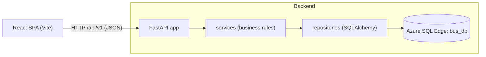

# Implementation Plan: Bus Seat Booking

**Branch**: `001-seat-booking` | **Date**: 2026-11-02 | **Spec**: [spec.md](spec.md)

**Input**: Feature specification from `/specs/001-seat-booking/spec.md`

## Summary

Users pick a bus, see every seat marked available or booked, select 1-6 available seats, choose a mock
user, and confirm. A FastAPI REST backend validates the request, books all seats in one database
transaction (all-or-nothing), and a unique constraint on `(bus_id, seat_number)` makes double-booking
impossible, including under concurrent requests. A React + Vite frontend renders the seat list and
re-fetches it after each booking so booked seats show as booked. Data lives in three tables (`buses`,
`users`, `bookings`) in `bus_db` on the Azure SQL Edge container that is already running in Colima. Schema
comes from Alembic; mock data comes from an idempotent seed command. A deterministic harness (`.harness/`,
built in the Foundational phase before any application code) runs integrity, lint, type, security, and test
gates and writes evidence under `evidence/`; implementation starts only after a human approves the artifacts.

## Technical Context

**Language/Version**: Python 3.12 (backend), TypeScript 5.x on Node 24 LTS-compatible tooling (frontend)

**Primary Dependencies**:

- Backend: FastAPI, Uvicorn, Pydantic v2, pydantic-settings, SQLAlchemy 2.0 (sync), pymssql, Alembic.
- Backend dev: pytest, pytest-cov, httpx2 (FastAPI `TestClient`), ruff, mypy, bandit, pip-audit.
- Environment (constitution v1.3.1): Python 3.12 via pyenv (`.python-version`), `.venv` at the repo root,
  dependencies declared in `src/backend/pyproject.toml` and locked with `uv` in `src/backend/uv.lock`.
- Frontend: React 18+, react-dom, react-router-dom (code-split routes).
- Frontend dev: Vite, TypeScript, Vitest, React Testing Library (`@testing-library/react`, `user-event`,
  `jest-dom`), jsdom, `@vitest/coverage-v8`, ESLint (`typescript-eslint`, `react-hooks`), Playwright (three
  end-to-end checks only: reload persistence, responsive overflow, and usability timing).

**Storage**: Azure SQL Edge (`mcr.microsoft.com/azure-sql-edge`), container `azure-sql-edge`, port 1433,
database `bus_db` (dev) and `bus_db_test` (tests). If already running it is reused untouched; `scripts/dev.sh`
starts it only when it is stopped or missing.

**Testing**: pytest (unit, contract, integration, perf marker); Vitest + React Testing Library; Playwright
for the three browser-level checks.

**Target Platform**: Local macOS (Apple Silicon) with Colima/Docker; browser at 320-1920 px.

**Project Type**: Web application (REST backend + SPA frontend).

**Performance Goals**: Seat list p95 < 300 ms; booking of up to 6 seats p95 < 500 ms (1,000 stored
bookings, bus up to 60 seats). Initial JS <= 200 KB gzipped.

**Constraints**: Stateless backend; secrets only from `.env`; all-or-nothing booking; exactly 1 success in
20 simultaneous attempts on one seat; no horizontal scroll at 320/768/1280 px.

**Scale/Scope**: 3 tables, 6 endpoints, 2 screens, about 10 mock rows; designed so more buses and users need
no code change.

No `NEEDS CLARIFICATION` items remain (see [research.md](research.md)).

## Constitution Check

*GATE: passed before Phase 0 and re-checked after Phase 1 design. Constitution v1.3.1.*

| Principle | How the plan complies | Status |
|-----------|----------------------|--------|
| I. SOLID / layering | `api -> services -> repositories -> models`; Protocols + `Depends`; frontend split into components, hooks, API client; an architecture test fails the build on an upward import | Pass |
| II. Validation | Pydantic schemas with `extra="forbid"`, bounds, duplicate check; ORM-only SQL; UI disables confirm on invalid state | Pass |
| III. Types | `mypy --strict`, TS `strict`, no `any`; frontend types mirror backend schemas (OpenAPI is the source) | Pass |
| IV. Errors | Typed domain exceptions, one handler module, single `{"error": {"code", "message"}}` shape, no leaks; React error boundary | Pass |
| V. Tests | Test matrix below maps every FR/NFR; coverage gates 85%/80% | Pass |
| VI. Secrets | `pydantic-settings` only; `.env` ignored; `.env.example` with placeholders; gitleaks gate; compose reads `.env` | Pass |
| VII. Security | CORS allow-list; unique constraint plus transactional insert; no credentials in logs/errors | Pass (authentication exempt under VII for mock-user features; see Complexity Tracking for `sa`) |
| VIII. Data model | 3 tables only; seats derived from `total_seats`; Alembic migration | Pass |
| IX. Scalable / simple | Stateless; paginated lists (default 20, max 100); `/api/v1`; OpenAPI | Pass |
| X. UI | React + Vite + TS; mobile-first CSS; lazy routes; no UI framework; loading/empty/error states | Pass |
| XI. Environment | Azure SQL Edge in Docker/Colima; compose + healthcheck; retry on start (constitution amended to v1.1.0 to name this image) | Pass |
| XII. Deterministic harness built first | `.harness/` (gates, thresholds, checksums, summariser, runner) created in the Foundational phase before any app code; evidence under `evidence/harness-results/`; repair bounded to 5 attempts | Pass |
| XIII. Agent guardrails and human approval | T001 approval gate in `evidence/harness-log.md`; phase-by-phase implementation with checkpoints; `initial-generation` tag and snapshot before the first `run.sh`; milestone commits | Pass |

Constraints table in the constitution: each row is mapped to a gate in "Testing and harness" below.

## Architecture



Request flow for `POST /api/v1/bookings`:

1. Router validates the body with a Pydantic schema (`422` on failure).
2. `BookingService.book_seats` loads the bus and user (`404` if missing) and checks each seat number is at most
   `total_seats` (`400`).
3. The service asks `BookingRepository.add_many` to insert one row per seat inside one transaction, with one
   `booked_at` (UTC from an injected `Clock`).
4. If the unique index rejects any row, the repository raises `SeatAlreadyBookedError`, the transaction rolls
   back (nothing stored), and the handler returns `409`.
5. The router maps the result to the `201` response.

Key decisions (details and alternatives in [research.md](research.md)):

- **The unique index is the single source of truth for conflicts.** The service does not "check then insert";
  it inserts and handles the violation, which is the only race-free approach.
- **Sync SQLAlchemy and sync endpoints.** FastAPI runs them in a thread pool; simplest model for pymssql.
- **pymssql driver.** Ships arm64 wheels and bundles FreeTDS, so no ODBC driver install (avoids Homebrew/proxy
  issues).
- **Seats are not rows.** `buses.total_seats` defines seats 1..N, keeping the model to 3 tables.
- **Alembic for schema, a separate seed command for data.** Seed is repeatable and never part of a migration.
- **No router library or data-fetching library in the frontend.** Native `fetch`, small hooks.

## Project Structure

### Documentation (this feature)

```text
specs/001-seat-booking/
├── plan.md
├── research.md
├── data-model.md
├── quickstart.md
├── contracts/
│   └── openapi.yaml
├── checklists/requirements.md
└── tasks.md              # created later by /speckit-tasks
```

### Source Code (repository root)

```text
docker-compose.yml                 # azure-sql-edge service, reads .env, TCP healthcheck
.env.example                       # variable names with placeholders only
.gitignore                         # + node_modules, dist, __pycache__, .coverage, coverage, .mypy_cache, .ruff_cache
.python-version                    # 3.12 (pyenv)
.venv/                             # root virtual environment (git-ignored)
README.md                          # setup and run steps
scripts/
├── dev.sh                         # single start command: ensure DB container (reuse if running), db-init, backend (8000), frontend (5173)
├── db-init.sh                     # wait for DB -> create database -> alembic upgrade -> seed
├── db-test-init.sh                # same for bus_db_test (also used by pytest session fixture)
└── e2e-backend.sh                 # backend on bus_db_test for the Playwright webServer

src/
├── backend/
│   ├── pyproject.toml             # deps, pytest and coverage config (no tool rules or thresholds)
│   ├── ruff.toml                  # lint rules (checksummed; complexity limit injected by lint.sh)
│   ├── mypy.ini                   # strict typing (checksummed)
│   ├── uv.lock                    # locked Python dependencies (committed)
│   ├── alembic.ini
│   ├── migrations/
│   │   ├── env.py
│   │   └── versions/0001_create_core_tables.py
│   └── app/
│       ├── main.py                # create_app(): routers, CORS, handlers
│       ├── core/
│       │   ├── config.py          # Settings (pydantic-settings), single env reader
│       │   ├── errors.py          # domain exceptions
│       │   └── clock.py           # Clock Protocol + SystemClock
│       ├── models/                # SQLAlchemy models: base.py, bus.py, user.py, booking.py
│       ├── repositories/          # protocols.py, bus_repository.py, user_repository.py, booking_repository.py
│       ├── services/              # types.py, bus_service.py, user_service.py, booking_service.py
│       ├── api/
│       │   ├── deps.py            # Depends wiring (session, repos, services, clock)
│       │   ├── error_handlers.py  # the only place exceptions become HTTP responses
│       │   ├── schemas/           # common.py (Page, ErrorResponse), bus.py, user.py, booking.py
│       │   └── v1/                # router.py, buses.py, users.py, bookings.py, health.py
│       └── db/
│           ├── session.py         # engine, session factory, retry-on-start
│           ├── admin.py           # create/drop database (master connection), used by scripts and tests
│           └── seed.py            # `python -m app.db.seed` (idempotent reset to mock data)
└── frontend/
    ├── package.json               # pinned deps via lockfile
    ├── vite.config.ts             # dev proxy /api -> http://localhost:8000; vitest config
    ├── tsconfig.json              # strict
    ├── eslint.config.js
    ├── index.html
    ├── src/
    │   ├── main.tsx
    │   ├── App.tsx                # routes, lazy-loaded pages, error boundary
    │   ├── api/                   # client.ts, types.ts, errors.ts, buses.ts, users.ts, bookings.ts
    │   ├── hooks/                 # useBuses, useBusDetail, useUsers, useSeatSelection, useBookSeats
    │   ├── components/            # BusList, SeatGrid, SeatItem, UserSelect, BookingBar, StatusMessage, ErrorBoundary
    │   ├── pages/                 # BusListPage, BusSeatsPage
    │   └── styles/global.css
    ├── tests/                     # Vitest + RTL (co-located with package.json so node_modules resolves)
    └── e2e/                       # Playwright: booking-persistence.spec.ts, responsive.spec.ts, usability.spec.ts

tests/
└── backend/
    ├── conftest.py                # test DB lifecycle, per-test reset, client fixtures
    ├── unit/                      # services with fake repos, schemas, settings, architecture test
    ├── contract/                  # every endpoint, success + failure, against bus_db_test
    └── integration/               # concurrency, rollback, seed idempotence, perf (marker)

.harness/
├── config/
│   ├── thresholds.env             # every numeric threshold (coverage, SAST level, bundle size, latency, complexity, function length)
│   ├── gitleaks.toml              # secret-scan config; allow-lists only .env, .venv, node_modules
│   └── checksums.sha256           # integrity checksums: harness scripts, thresholds, gitleaks, ruff, mypy, eslint, tsconfig
├── integrity.sh                   # gate 0: verifies checksums.sha256
├── lint.sh                        # gate 1: ruff, mypy, function length, eslint, tsc
├── security.sh                    # gate 2: bandit, pip-audit, npm audit, gitleaks
├── test.sh                        # gate 3: pytest + vitest with coverage thresholds, no skipped tests
├── build.sh                       # gate 4: vite build + bundle size
├── e2e.sh                         # gate 5: Playwright against the test database
├── check_function_length.py       # fails if a Python function exceeds 40 lines
├── check_bundle_size.mjs          # fails if initial JS exceeds the threshold (gzipped)
├── redact.sh                      # strips secret values from captured output
├── summarize.py                   # builds summary.json: failed rule/test with expected vs observed
└── run.sh                         # runs every gate, writes evidence, appends a row to harness-log.md

evidence/
├── initial-generation/            # first generated implementation, unmodified (also tag initial-generation)
├── final-generation/
├── harness-results/               # per-run folder with runner-generated summary + logs
└── harness-log.md                 # Approval, generation, repairs, quickstart, convergence, traceability, decision, run table
```

**Structure Decision**: Web application layout from the constitution (`src/`, `tests/`, `.harness/`,
`evidence/`). Backend tests live in `tests/backend`. Frontend tests live in `src/frontend/tests` because
Vitest must resolve `node_modules` from the frontend package; this is the "where tooling requires" exception
the constitution allows.

## Endpoints

Base path `/api/v1`. Full schemas in [contracts/openapi.yaml](contracts/openapi.yaml).

| Method | Path | Purpose | Success | Errors |
|--------|------|---------|---------|--------|
| GET | `/buses?page&page_size` | Paginated bus list | 200 | 422 |
| GET | `/buses/{bus_id}` | Bus with every seat and its status | 200 | 404 `bus_not_found`, 422 |
| GET | `/users?page&page_size` | Paginated user list for the selector | 200 | 422 |
| POST | `/bookings` | Book 1-6 seats (all-or-nothing) | 201 | 400 `invalid_seat`, 404 `bus_not_found` / `user_not_found`, 409 `seat_unavailable`, 422 `validation_error`, 503 |
| GET | `/health` | Liveness | 200 | - |
| GET | `/health/ready` | Readiness (runs `SELECT 1`) | 200 | 503 |

The seat list is returned inside the bus response and is not paginated because it is bounded by the
`total_seats` check constraint (at most 60); this is documented in the contract.

## Data Model

Summary (full DDL, constraints, and validation rules in [data-model.md](data-model.md)):

- `buses(id, name, total_seats)`; `users(id, name)`; `bookings(id, bus_id, user_id, seat_number, booked_at)`.
- `UNIQUE (bus_id, seat_number)` on `bookings` is the double-booking guard and the index used to load a bus's
  seat statuses.

## Frontend Components

| Component | Responsibility | Notes |
|-----------|----------------|-------|
| `App` | Routes `/` and `/buses/:busId`, lazy pages, error boundary | Code-splitting per route |
| `BusListPage` | Fetch buses via `useBuses`, render `BusList` | Loading / empty / error via `StatusMessage` |
| `BusSeatsPage` | Compose seat grid, user selector, booking bar | Owns selection state and refresh after booking |
| `BusList` | Presentational list of buses with seat counts | Links to the seat page |
| `SeatGrid` / `SeatItem` | Presentational seat list; each seat is a button with text "Seat N, available/booked/selected" | Booked seats are `disabled`; state is shown with a text label and icon, not colour alone |
| `UserSelect` | Labelled select of users | Required before confirm |
| `BookingBar` | Selected seats summary and Confirm button | Disabled when no user, no seats, more than 6 seats, or request in flight |
| `StatusMessage` | Loading, empty, error (with retry), success, conflict notices | `role="status"` / `role="alert"` |
| `ErrorBoundary` | Catches render failures | Constitution IV |

Hooks (no component calls `fetch`): `useBuses`, `useBusDetail(busId)` (with `refresh()`), `useUsers`,
`useSeatSelection(maxSeats = 6)` (toggle, clear, limit), `useBookSeats` (submit, status, error mapping).
The API client maps backend error codes to three UI messages: "seat no longer available" (409), "invalid
request" (400/422/404), "service unavailable" (503/network).

## Error Handling

| Source | Domain exception | HTTP | `error.code` |
|--------|------------------|------|--------------|
| Schema / query / path validation | FastAPI `RequestValidationError` (re-shaped) | 422 | `validation_error` |
| Seat beyond `total_seats` | `InvalidSeatError` | 400 | `invalid_seat` |
| Unknown bus | `BusNotFoundError` | 404 | `bus_not_found` |
| Unknown user | `UserNotFoundError` | 404 | `user_not_found` |
| Unique-index violation on insert | `SeatAlreadyBookedError` | 409 | `seat_unavailable` |
| DB unreachable / timeout | SQLAlchemy `OperationalError` | 503 | `service_unavailable` |
| Anything else | unhandled | 500 | `internal_error` (generic text; traceback logged server-side only) |

All responses use `{"error": {"code": "...", "message": "..."}}`. Logging uses the stdlib `logging` module
and never logs request bodies containing credentials or connection strings.

## Testing and Harness

Test matrix (each requirement has at least one automated test; IDs are test-name prefixes):

| Spec item | Test level | What the test asserts |
|-----------|------------|-----------------------|
| US1.1-1.3, FR-007/008/009 | contract | bus list, 20 available seats, booked seat shown, users list |
| US1.4, US2.5 | contract | 404 codes `bus_not_found`, `user_not_found`, no row stored |
| US2.1, FR-012/013/016 | contract + unit | 201; one row per seat; shared UTC `booked_at` from fake clock; response body |
| US2.2, US2.3, US2.6 | contract + unit | 422 for empty, duplicate, more than 6, seat 0, negative |
| US2.4 | contract | seat 21 on 20-seat bus gives 400 `invalid_seat` |
| US3.1 | contract + e2e | seat shows booked on re-read and after browser reload |
| US3.2, US3.3, FR-014 | integration | 409 and unchanged table; seats 8, 9 stay free when 7 conflicts |
| US3.4, NFR-003 | integration | 20 threads, same seat: exactly 1 `201`, 19 `409`, 1 row |
| US3.5 | contract | bookings are per bus |
| FR-001/002/005/006 | integration | schema has 3 tables; seed gives 3 buses and 3 users with known ids and empty bookings; reseed resets; duplicate `(bus, seat)` rejected by DB |
| FR-017, NFR-004 | unit + contract | single error shape; 500 body contains no stack trace or SQL |
| NFR-001/002 | perf (marker) | p95 below 300 ms and 500 ms with 1,000 bookings |
| NFR-005 | integration | failed requests leave bookings table identical |
| NFR-004 / VI | unit | settings fail fast when a variable is missing; secret scan clean |
| Constitution XI, endpoint rule | unit + contract | app waits for the DB at startup and refuses to serve if it never answers; `/health` and `/health/ready` success and 503 paths |
| FR-018 to FR-024, US4 | Vitest + RTL | seat states and labels, select/deselect, limit of 6, confirm enablement, user selector, success, conflict refresh, error and retry, loading, empty |
| NFR-006 | e2e (Playwright) | no horizontal overflow at 320, 768, 1280 px |
| NFR-007 | build gate + e2e | initial JS <= 200 KB gzipped; bus list visible within 2 s |
| NFR-008, SC-001, SC-002 | e2e (Playwright) | one-seat booking in <= 5 interactions and < 30 s; seat list visible within 2 s of choosing a bus |
| Edge case: refresh before confirm | RTL + e2e | unconfirmed selection is empty after reload; nothing stored |
| NFR-009 | RTL | seats reachable by keyboard; each has an accessible name with number and status |
| Architecture (I) | unit | AST scan: no upward imports; no `fetch` in components |
| DB tooling (XI, V coverage) | unit + integration | name validation, test-database drop guard, `UtcDateTime` conversions, `unit_of_work` commit/rollback, seed CLI, admin create/recreate on a scratch `*_test` database |

Harness (`.harness/run.sh`, built in the Foundational phase, constitution XII) runs these gates in order and
continues after a failure so all evidence is collected. Each run writes `evidence/harness-results/<timestamp>/`
(stdout, stderr, exit code per gate, junit, coverage, `summary.json`) and appends a row to the run table at the
end of `evidence/harness-log.md`:

0. Integrity: `shasum -c .harness/config/checksums.sha256` (harness scripts, `thresholds.env`, `gitleaks.toml`, and the
   ruff, mypy, ESLint, and tsconfig files unchanged).
1. Lint/types: `ruff check`, `ruff format --check` (C901 max 10), `mypy --strict`, `check_function_length.py`
   (40 lines), `eslint --max-warnings 0` (`max-lines-per-function` 40), `tsc --noEmit`.
2. Security: `bandit` at the `SAST_FAIL_LEVEL` from thresholds, `pip-audit`, `npm audit --audit-level=high`,
   `gitleaks dir` on the working tree and `gitleaks git` on history, both with `config/gitleaks.toml` (secret scan;
   `.env` is allow-listed because it is git-ignored and legitimately holds the DB password).
3. Tests: `pytest --cov --cov-branch` (85% line, 80% branch) and `vitest --coverage` (80%), thresholds read from
   `thresholds.env`; any skipped or xfail test fails the gate.
4. Build: `vite build` then `check_bundle_size.mjs`.
5. E2E: the three Playwright specs against the test database, with Playwright `webServer` starting the backend
   through `scripts/e2e-backend.sh` (Chromium download is blocked by the corporate proxy and Edge forbids remote
   debugging by managed policy, so the manually installed Chrome Canary is used via `channel: "chrome-canary"`).

`summarize.py` extracts each failed test's expected-versus-observed message from the junit report so failure
evidence can be fed to the coding agent. A unit test exercises `summarize.py` with fixture data.

How the harness is used while implementing (constitution XII and XIII):

1. **T001 approval gate**: a human records `APPROVED` for spec, plan, and tasks before any other task starts.
2. **Harness first**: the Foundational phase creates `.harness/` and its checksums; from then on every phase
   checkpoint runs the individual gate scripts (`lint.sh`, `test.sh`, ...) as development checks. Those runs are
   not evidence.
3. **Snapshot**: after the last implementation task, commit, tag `initial-generation`, and copy `src/` and
   `tests/` to `evidence/initial-generation/`.
4. **First recorded run**: `.harness/run.sh`. Failures are given to the agent with the evidence folder, repaired,
   and the same gates re-run unchanged (maximum 5 attempts per gate, then escalate).
5. **Convergence and decision**: `/speckit-converge`, final copy to `evidence/final-generation/`, then the human
   ACCEPT/REJECT entry.

`evidence/harness-log.md` is written by hand only for narrative sections (approval, context, repair description,
traceability, human decision); gate results come from the runner.

## Test Database Population

Two databases on the same container: `bus_db` (development) and `bus_db_test` (tests). The test database name
is derived as `<DB_NAME>_test`, and the test fixtures refuse to run if the connected database name does not
end in `_test`.

Development database (`scripts/db-init.sh`):

1. Wait until the container accepts TCP on `DB_HOST:DB_PORT` and a `SELECT 1` succeeds (retry up to 60 s).
2. Connect to `master` and `CREATE DATABASE bus_db` if it does not exist (`app.db.admin`).
3. `alembic upgrade head` creates `buses`, `users`, `bookings` with all constraints.
4. `python -m app.db.seed` resets data: `TRUNCATE` `bookings`, delete `users` and `buses`, insert mock rows
   with explicit ids (identity insert): buses "Bus A" (20 seats, id 1), "Bus B" (30, id 2), "Bus C" (40, id 3);
   users "Asha" (id 1), "Ravi" (id 2), "Meera" (id 3); bookings empty. Re-running yields the identical state.

Test database (`tests/backend/conftest.py`, session scope):

1. Compute the test database name; assert it ends in `_test`.
2. Drop (if exists) and create `bus_db_test` through the `master` connection.
3. Run `alembic upgrade head` programmatically against it (same migration as production, so the schema under
   test is the real schema).
4. Function-scope autouse fixture: run the seed reset before every test so each test starts from the known
   state (real commits are required for the concurrency test, so rollback-based isolation is not used).
5. Session teardown leaves the database in place for debugging; the next session drops and recreates it.

## Missing Steps Added to the Plan

| # | Gap found | Plan decision |
|---|-----------|---------------|
| 1 | Constitution named `mssql/server`, user mandates Azure SQL Edge | Constitution amended to v1.1.0 (done) |
| 2 | Azure SQL Edge is retired by Microsoft (image still pullable) | Portable T-SQL only; documented swap to `mssql/server`; risk recorded |
| 3 | `.env` has `DB_NAME`, `DB_USER` (`sa`), `DB_PASSWORD` only | Add optional `DB_HOST`/`DB_PORT`/`CORS_ORIGINS` defaults in code; `.env.example` created; `.env` untouched by the agent |
| 4 | `.gitignore` lacks Node/Python build artefacts | Extend it (`node_modules`, `dist`, caches, coverage) |
| 5 | Existing container was started by hand, not by compose | Compose file added for fresh clones; `scripts/dev.sh` reuses the running hand-started container, starts it if stopped, and creates one only when missing; replacing it with a compose-managed one needs your confirmation (T125) |
| 6 | Image has no `sqlcmd` | TCP healthcheck plus application-level readiness `SELECT 1` and startup retry |
| 7 | Constitution wants a migration tool | Alembic with one migration `0001` |
| 8 | Reproducible test DB and deterministic ids | Seed truncates bookings and inserts buses/users with explicit ids 1-3 |
| 9 | Naive datetimes in SQL Server | `DATETIME2` stored as UTC; API serialises ISO-8601 with `Z` |
| 10 | Function length gate not available in Ruff | Small AST script `check_function_length.py` |
| 11 | Responsive and reload checks cannot run in jsdom | Three Playwright specs (reload persistence, responsive overflow, usability timing); Chromium download is blocked by the corporate proxy (verified) and Edge forbids remote debugging by managed policy `RemoteDebuggingAllowed=0` (verified), so use the manually installed Chrome Canary via `channel: "chrome-canary"` |
| 12 | Layering rule needs enforcement | Architecture unit test (AST import scan) |
| 13 | Frontend/back-end type drift | Frontend types hand-written to mirror `openapi.yaml`; a contract test compares the app's generated OpenAPI against the committed file |
| 14 | CORS and dev proxy | Vite proxy for `/api`; backend CORS allow-list from `CORS_ORIGINS` (default `http://localhost:5173`) |
| 15 | Preserve first generation | After the last implementation task and before the first `run.sh`: commit, tag `initial-generation`, and copy `src/` and `tests/` to `evidence/initial-generation/` |
| 16 | Evidence log scaffold | `evidence/harness-log.md` is created by T001 with the Approval section and empty placeholders for every later section in the constitution's order; tasks fill them in place and the runner appends the run table last |
| 17 | README and one-command start | `README.md` with prerequisites, commands from [quickstart.md](quickstart.md) |
| 18 | Double-click and retry safety | UI disables Confirm while in flight; server conflict handling makes repeats safe |
| 19 | NFR-011 needs one start command | `scripts/dev.sh` ensures the DB is up (Colima started if needed; a running container is reused untouched, a stopped one is started, a missing one is created; a foreign process on the DB port aborts), then runs db-init, backend, and frontend |
| 20 | Ids and seat numbers unbounded | Schemas cap them at 2,147,483,647 (SQL `INT`) so oversized values return 422, not 500 |
| 21 | First implementation attempt never reached the harness (harness tasks were last; the agent ran ahead without an approval gate or checkpoints) | Harness built in the Foundational phase; T001 human approval gate; phase-by-phase checkpoints; constitution v1.3.1 (XII, XIII) |
| 22 | Thresholds, gate scripts, and lint/type/secret-scan configuration could be weakened by the agent | Numeric thresholds only in `config/thresholds.env` (injected into ruff, ESLint, and the perf tests); `checksums.sha256` covers the scripts, thresholds, `gitleaks.toml`, `ruff.toml`, `mypy.ini`, `eslint.config.js`, and `tsconfig.json`, verified by gate 0 |
| 23 | Failure evidence was not captured in a form the agent can consume | `summarize.py` writes `summary.json` with expected vs observed per failed test; runner appends to `harness-log.md` |
| 24 | No milestone history (lab sheet Part H) | Conventional commits per milestone; `initial-generation` tag; approved artifacts committed first |
| 25 | Pip requirements files conflict with the uv convention | `pyproject.toml` + `uv.lock`, pyenv 3.12, root `.venv` (constitution v1.3.0) |
| 26 | Tests were written together with code, not first | Every test task precedes its implementation task and must be seen failing before the implementation task starts |

## Complexity Tracking

| Violation / risk | Why Needed | Simpler Alternative Rejected Because |
|------------------|------------|-------------------------------------|
| Application connects as `sa` (from `.env`, `DB_USER="sa"`) | Dictated by the existing container and `.env`; this is a local mock-data environment | A least-privilege login is better for any shared or production use; deferred, and the app only needs `DB_USER` swapped to adopt it |
| Playwright dev dependency | Spec requires reload persistence (SC-003), responsive checks (SC-006), and timed interaction checks (SC-001, SC-002, NFR-007, NFR-008), which jsdom cannot verify | Skipping them would leave four success criteria without a binary test |
| No authentication or authorisation; any client can book as any mock user | Spec Assumptions put sign-in out of scope; users are mock rows picked in the UI. Constitution v1.2.0 exempts mock-user features until a dedicated iteration adds them | Token authentication needs a login flow, a credentials model and session handling, which belongs to a separate iteration and must be in place before any real use |
| Alembic for three tables | Constitution VIII requires versioned migrations | Raw SQL script would allow untracked schema drift |
| Repository layer for a small app | Constitution I requires it; also lets service unit tests run with fake repositories | Direct ORM calls in services would break layering |
