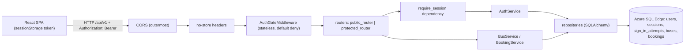

# Implementation Plan: User Authentication for Bus Booking

**Branch**: `002-user-authentication` | **Date**: 2026-11-03 | **Spec**: [spec.md](spec.md)

**Input**: Feature specification from `/specs/002-user-authentication/spec.md` (including the four clarifications of
2026-11-03)

## Summary

Every mock user gets a username and an Argon2id password hash. `POST /auth/login` accepts exactly a username and a
password and, only for an exact matching pair, starts a **session** (a row in a new `sessions` table) and returns a
signed 30-minute token. The token travels in an `Authorization: Bearer` header and is kept by the SPA in
`sessionStorage`, so a sign-in belongs to one tab. Every API operation except sign-in and the two health checks is
protected in two places: a default-deny gate (rejects calls without a correctly signed token before any body is read)
and a router-level dependency (loads the session, checks it has not ended or expired against an injected clock, and
supplies the current user). Sign-out ends the session in the database, so the old token is refused at once everywhere.
Bookings take their user from the session; a `user_id` in the body is rejected, and the 001 user list and user
selector are removed. Repeated failures for one username are throttled (5 in 5 minutes, then a 60-second block),
recorded in a `sign_in_attempts` audit table. The change follows the existing layering (`api -> services ->
repositories -> models`), the existing error shape, red-first tests, and the already built harness.

## Technical Context

**Language/Version**: Python 3.12 (backend), TypeScript 5.x on Node 24 LTS-compatible tooling (frontend); unchanged.

**Primary Dependencies**:

- Backend, **new (2)**: `PyJWT` (token signing and verification) and `argon2-cffi` (Argon2id password hashing); both
  pinned through `uv` in `src/backend/uv.lock` and covered by the `pip-audit` gate. Verified: binary wheels exist for
  this machine (research 1).
- Backend, unchanged: FastAPI, Uvicorn, Pydantic v2, pydantic-settings, SQLAlchemy 2.0 (sync), pymssql, Alembic.
- Frontend: **no new dependency**. Existing React 18+, react-router-dom, Vitest + React Testing Library, Playwright.
- Environment (constitution v1.4.1): Python 3.12 via pyenv, root `.venv`, `uv`; unchanged.

**Storage**: Azure SQL Edge container reused as is; `bus_db` (dev) and `bus_db_test` (tests). Migration `0002` adds two
columns to `users` and the tables `sessions` and `sign_in_attempts` ([data-model.md](data-model.md)).

**Testing**: pytest (unit, contract, integration, perf marker), Vitest + RTL, Playwright (existing three specs get a
sign-in step; one new spec for authentication).

**Target Platform**: Local macOS (Apple Silicon) with Colima/Docker; browser 320-1920 px.

**Project Type**: Web application (REST backend + SPA frontend); unchanged.

**Performance Goals**: sign-in p95 < 500 ms (NFR-005); protection overhead <= 50 ms p95 per protected call, so the 001
targets still hold (seat list < 300 ms, booking < 500 ms) (NFR-006); identical failure timing within 50 ms (NFR-003).

**Constraints**: stateless backend (sessions and counters in the database); secrets only in `.env` (`JWT_SECRET`,
`MOCK_USER_PASSWORDS`); no password or token in logs, errors, evidence, or URLs; sign-out effective immediately;
every route outside the public list is protected by default.

**Scale/Scope**: 5 tables (2 new), 3 new endpoints (`/auth/login`, `/auth/logout`, `/auth/me`), 1 removed (`/users`),
1 changed (`POST /bookings`), 2 protected reads, 3 screens (login plus the existing 2), 3 mock users.

No `NEEDS CLARIFICATION` items remain (see [research.md](research.md)). One process decision (evidence layout,
research 14) and one protected-file change (redaction, research 15) need explicit human confirmation at the approval
gate; they are listed in "Missing Steps Added to the Plan".

## Constitution Check

*GATE: passed before Phase 0 and re-checked after Phase 1 design. Constitution v1.4.1.*

| Principle | How the plan complies | Status |
|-----------|----------------------|--------|
| I. SOLID / layering | New code follows `api -> services -> repositories -> models`. `AuthService` depends on small Protocols (`CredentialReader`, `SessionStore`, `AttemptLog`, `PasswordVerifier`, `TokenCodec`, `Clock`) injected through `Depends`; routers hold no logic; the gate middleware only checks a signature and never touches the database; repositories hold all SQL; frontend keeps components, hooks, and an API client, and only `api/session.ts` touches storage. The architecture tests (Python import scan; no `fetch`/storage access in components) extend to the new modules. | Pass |
| II. Validation | Login body: `extra="forbid"`, username 1-50, password 1-128 (kept as typed). Booking body loses `user_id` and keeps `extra="forbid"`. Auth is checked before body parsing. Parameterised ORM queries only. The login form validates before submit (usability only). | Pass |
| III. Types | `mypy --strict`, TS `strict`. PyJWT returns untyped claims: the codec converts them into a frozen dataclass at one boundary with a one-line justification comment; the type-hygiene test covers it. Frontend auth types mirror [contracts/openapi.yaml](contracts/openapi.yaml). | Pass |
| IV. Errors | New typed errors `UnauthenticatedError` (401), `InvalidCredentialsError` (401), `TooManyAttemptsError` (429) in `core/errors.py`; one function in `error_handlers.py` turns them into the common `{"error": {"code", "message"}}` shape. The 401 text never says why a credential failed. Login rejections are returned as values so the attempt row commits (research 5). The UI shows a message for every failure kind. | Pass |
| V. Tests | Test matrix below maps every FR, NFR, user story scenario, and success criterion; red-first per task; every endpoint has success and failure tests; coverage 85%/80% unchanged. | Pass |
| VI. Secrets | `JWT_SECRET` and `MOCK_USER_PASSWORDS` only in `.env`, read only by `core/config.py`; `.env.example` has placeholders; tests generate random passwords and carry none; the seed refuses to run without them and never prints them; redaction extended (research 15, human-approved); gitleaks gate unchanged. | Pass |
| VII. Security | Fully applies now: Argon2id salted hashes, signed short-lived tokens, server-side session check on every protected call, CORS allow-list (header `authorization` added, no wildcard), uniform failures and equal timing, throttling, `no-store`. The mock-user exemption sentence of VII is satisfied by this feature; retiring it is a separate amendment (Missing Steps 11). | Pass |
| VIII. Data model | Two tables and two columns, each justified in [data-model.md](data-model.md) and the spec's Key Entities; surrogate keys, explicit FKs, indexes only for documented queries; versioned Alembic migration `0002` (no manual edits, no edit of `0001`). | Pass |
| IX. Scalable / simple | Stateless: sessions and attempt counts live in the database, so any number of instances agree. No new lists, so no pagination change. API stays under `/api/v1` and the OpenAPI schema. Two new dependencies and two enforcement layers are justified in Complexity Tracking. | Pass |
| X. UI | React + Vite + TS; no new UI dependency; login page code-split; mobile-first CSS for the form and header; labelled fields, keyboard operation, `role="alert"` messages, loading state while the session is being checked. | Pass |
| XI. Environment | Same container and `scripts/`; `db-init.sh` and `db-test-init.sh` already run migrations then seed, so `0002` and the hashed seed run in the existing sequence; README updated. | Pass |
| XII. Deterministic harness | No harness script, threshold, or protected configuration is edited by default; the harness is reused unchanged and gates still run in order. The only candidate change (`redact.sh`) is a separate human-approved task with a regenerated checksum. Failure logging (v1.4.0) is planned as a task step. | Pass |
| XIII. Agent guardrails | T001 human approval gate for this feature's spec, plan, and tasks, citing v1.4.1; phase-by-phase work with checkpoints; first generation tagged `002-initial-generation` (the `<NNN>-initial-generation` form that Principle XIII allows since v1.4.1) and snapshotted before the first `run.sh`; final ACCEPT/REJECT written by the human only. | Pass |

Constraints table: each row maps to a gate in "Testing and Harness"; no threshold changes.

## Architecture



Request flows:

**Sign-in `POST /api/v1/auth/login`** (public)

1. The gate sees a public route and lets it through. The router validates the body (422 on failure).
2. `AuthService.login` asks `AttemptLog` for the failures of that username (5 within 5 minutes, less than 60 s since
   the last) and returns `LoginRejected(TooManyAttemptsError)` if throttled, recording a `throttled` row.
3. Otherwise it loads the user by username, requires an exact Python match, and verifies the password with one Argon2
   check (a fixed dummy hash for unknown users, so timing is equal). On mismatch it records `failure` and returns
   `LoginRejected(InvalidCredentialsError)`.
4. On a match it creates a `sessions` row (`started_at` from the `Clock`, `expires_at` = start + 30 minutes), records
   `success`, signs the token (`sid`, `sub`, `iat`, `exp`), and returns `LoginSuccess`.
5. The route returns the `200` body, or, for a rejection, the response built by `response_for(error)` from
   `error_handlers.py`. Because nothing is raised, the request transaction commits the attempt row in every case.

**Protected call (for example `POST /api/v1/bookings`)**

1. `AuthGateMiddleware`: the request matches a registered, non-public route, so it needs `Authorization: Bearer <t>`
   with a valid signature; otherwise `401 unauthenticated`, before any body is parsed (this is why a malformed JSON
   body also gets 401). A path that matches no route falls through to the normal `404`.
2. `require_session` (router dependency): `AuthService.authenticate` decodes the token again, loads the session and
   its user by primary key, and requires `ended_at IS NULL` and `now < expires_at` (injected clock). Any failure is
   `401 unauthenticated` with the same body.
3. The endpoint receives `CurrentUser(id, name, session_id)`, validates the body (`bus_id`, `seat_numbers` only), and
   calls `BookingService.book_seats(bus_id, current_user.id, seats)`; the booking rules from 001 are unchanged.

**Sign-out `POST /api/v1/auth/logout`**: authenticated as above; `AuthService.logout` sets `ended_at`, records
`signout`, and the route returns `204`. The commit happens before the response is sent (existing `scope="function"`
session dependency), so a call made after the response always sees the ended session (NFR-007).

Key decisions (details and alternatives in [research.md](research.md)):

- **Hybrid credential**: a signed token (constitution VII) plus a server-side session row (sign-out and expiry are
  authoritative). Pure stateless tokens cannot be revoked.
- **Argon2id, not bcrypt**: passwords up to 128 characters must all count; bcrypt uses only 72 bytes.
- **Default-deny gate in front of a dependency check**: verified that FastAPI parses the JSON body before dependencies
  run, so only a middleware can return 401 first for a malformed body.
- **The gate has no database access and never decides expiry**: that keeps it cheap, keeps services behind `Depends`,
  and keeps expiry testable with the fake clock.
- **Login returns values, not exceptions**: failures must be stored and the request session rolls back on raise.
- **Exact username match done in Python**: SQL Server comparisons ignore case and trailing spaces.
- **Throttle and audit in one table**: one write path, one index, stateless, per username as clarified.
- **Per-tab sign-in**: `sessionStorage` plus an `Authorization` header; no cookie, hence no CSRF surface.
- **User identity only from the session**: `user_id` leaves the booking contract; the user list and selector go.
- **Mock passwords from `.env` only**: random per-session passwords in tests; the seed fails closed without them.

Dependencies and their reason:

| Dependency | Kind | Why |
|------------|------|-----|
| `argon2-cffi` (+ `argon2-cffi-bindings`) | new, runtime | Argon2id hashing; constitution VII; no 72-byte limit |
| `PyJWT` | new, runtime | Signed short-lived token; constitution VII; pinned HS256 |
| `JWT_SECRET` (env, >= 32 chars) | new setting, required at start-up | Token signing key; constitution VI |
| `MOCK_USER_PASSWORDS` (env, JSON) | new setting, optional at start-up, required by the seed | Mock credentials without secrets in source |
| Feature 001 `Clock`, `unit_of_work`, `error_responses`, `Identifier` | reused | Time, transactions, error shape, id bounds |
| Feature 001 harness, `db-init.sh`, `db-test-init.sh`, `dev.sh` | reused | Gates, schema and seed sequence, one start command |

## Project Structure

### Documentation (this feature)

```text
specs/002-user-authentication/
├── plan.md
├── research.md
├── data-model.md
├── quickstart.md
├── contracts/openapi.yaml     # supersedes the 001 contract; 001's file stays as the historical record
├── checklists/requirements.md
└── tasks.md                   # created later by /speckit-tasks
```

### Source Code (changes to the repository root)

`+` new, `~` changed, `-` removed. Everything else is untouched.

```text
.env.example                                  ~ + JWT_SECRET, MOCK_USER_PASSWORDS (placeholders only)
README.md                                     ~ credentials setup, sign-in, how to find mock usernames
scripts/                                      (unchanged: db-init.sh and db-test-init.sh already migrate then seed;
                                               e2e-backend.sh and e2e-reset.sh seed from .env)

src/backend/
├── pyproject.toml, uv.lock                   ~ + PyJWT, argon2-cffi
├── migrations/versions/0002_add_authentication.py   +
└── app/
    ├── main.py                               ~ add gate and no-store middleware; CORS allow_headers + "authorization"
    ├── core/
    │   ├── config.py                         ~ jwt_secret (>= 32), mock_user_passwords, auth policy defaults
    │   ├── errors.py                         ~ + UnauthenticatedError, InvalidCredentialsError, TooManyAttemptsError; - UserNotFoundError
    │   ├── passwords.py                      + PasswordVerifier Protocol, Argon2Hasher (hash, verify, dummy verify)
    │   └── tokens.py                         + TokenCodec Protocol, JwtTokenCodec, TokenClaims, get_token_codec()
    ├── models/
    │   ├── user.py                           ~ + username, password_hash
    │   ├── session.py                        + UserSession (table sessions)
    │   └── sign_in_attempt.py                + SignInAttempt
    ├── repositories/
    │   ├── protocols.py                      ~ + CredentialReader, SessionStore, AttemptLog; UserReader slimmed
    │   ├── user_repository.py                ~ get_by_username; list_page/count removed
    │   ├── session_repository.py             +
    │   └── sign_in_attempt_repository.py     +
    ├── services/
    │   ├── auth_service.py                   + login, authenticate, logout, throttle
    │   ├── booking_service.py                ~ no user lookup
    │   ├── types.py                          ~ + Principal, LoginSuccess, LoginRejected; - UserSummary
    │   └── user_service.py                   - removed
    ├── api/
    │   ├── deps.py                           ~ AuthService wiring, require_session, CurrentUserDep, policy, codec
    │   ├── error_handlers.py                 ~ new codes; response_for(error); Retry-After and WWW-Authenticate headers
    │   ├── middleware/
    │   │   ├── auth_gate.py                  + AuthGateMiddleware (public routes come from public_router)
    │   │   └── no_store.py                   + Cache-Control: no-store on /api/v1 responses
    │   ├── schemas/auth.py                   + LoginRequest, LoginResponse, AuthUser
    │   ├── schemas/booking.py                ~ - user_id
    │   ├── schemas/user.py                   - removed
    │   └── v1/
    │       ├── router.py                     ~ public_router (health, login) and protected_router (everything else)
    │       ├── auth.py                       + login (public), logout, me (protected)
    │       ├── bookings.py                   ~ CurrentUser supplies the user
    │       └── users.py                      - removed
    └── db/seed.py                            ~ users with usernames; reset_data(session, password_hashes); CLI hashes from settings

src/frontend/
├── src/
│   ├── api/session.ts, auth.ts               + token storage (only storage access), login/logout/me
│   ├── api/client.ts, errors.ts, types.ts    ~ bearer header, 401/429 kinds, auth types; users.ts removed
│   ├── hooks/useAuthSession.ts               + checking / signedIn / signedOut state machine
│   ├── hooks/useUsers.ts                     - removed
│   ├── components/AuthProvider.tsx, RequireAuth.tsx, AppHeader.tsx, LoginForm.tsx   +
│   ├── components/UserSelect.tsx             - removed;  BookingBar.tsx ~ (no user requirement)
│   ├── pages/LoginPage.tsx                   + (lazy);  BusSeatsPage.tsx ~ no user selector
│   └── App.tsx                               ~ /login route, RequireAuth around the existing routes
├── tests/                                    ~ new and updated Vitest files (matrix below)
└── e2e/auth.spec.ts, support.ts              + sign-in helper; existing specs sign in first

tests/backend/
├── conftest.py                               ~ credentials fixture, hasher, auth_headers(username), reset with hashes
├── unit/                                     + passwords, tokens, auth service, gate, throttle, settings, schemas
├── contract/                                 + login, logout, me, bypass suite, route enumeration, users removed; ~ existing add auth
└── integration/                              + migration 0002, seed, sign-out immediacy, throttle in DB, perf; ~ concurrency uses auth
```

**Structure Decision**: unchanged web-application layout; new backend modules slot into the existing layers and the
frontend keeps its `api / hooks / components / pages` split.

## Endpoints

Base path `/api/v1`. Full schemas in [contracts/openapi.yaml](contracts/openapi.yaml).

| Method | Path | Auth | Purpose | Success | Errors |
|--------|------|------|---------|---------|--------|
| POST | `/auth/login` | public | Sign in with username and password | 200 | 401 `invalid_credentials`, 422, 429 `too_many_attempts`, 503 |
| POST | `/auth/logout` | session | End the current session | 204 | 401 `unauthenticated`, 503 |
| GET | `/auth/me` | session | Current user (id, name) | 200 | 401, 503 |
| GET | `/buses?page&page_size` | session | Paginated bus list | 200 | 401, 422, 503 |
| GET | `/buses/{bus_id}` | session | Bus with every seat and status | 200 | 401, 404 `bus_not_found`, 422, 503 |
| POST | `/bookings` | session | Book 1-6 seats for the session's user | 201 | 400 `invalid_seat`, 401, 404 `bus_not_found`, 409 `seat_unavailable`, 422, 503 |
| GET | `/health`, `/health/ready` | public | Liveness, readiness | 200 | 503 (ready only) |
| GET | `/users` | removed | (404 signed in or not) | - | `not_found` |

## Error Handling

New and changed rows (the other rows of the 001 table stay):

| Source | Domain error | HTTP | `error.code` | Notes |
|--------|--------------|------|--------------|-------|
| Missing, malformed, forged, altered, wrong-scheme, expired, signed-out credential | `UnauthenticatedError` (or the gate) | 401 | `unauthenticated` | one message, header `WWW-Authenticate: Bearer` |
| Unknown username, wrong password, another user's password, inexact username | `InvalidCredentialsError` | 401 | `invalid_credentials` | identical body for all; never `unauthenticated` |
| 5 failures in 5 minutes, less than 60 s since the last | `TooManyAttemptsError` | 429 | `too_many_attempts` | message "Try again in N seconds."; `Retry-After: N` |
| Booking body with `user_id` or any extra field | Pydantic | 422 | `validation_error` | field names only, never values |
| Unknown bus | `BusNotFoundError` | 404 | `bus_not_found` | unchanged |
| `UserNotFoundError` | removed | - | - | the session proves the user exists |
| Gate rejection | `AuthGateMiddleware` | 401 | `unauthenticated` | built with the same `error_response` function |

Logging: the stdlib `logging` module records sign-in outcomes by username and result only; passwords, hashes, and
tokens are never passed to a logger, and exception messages are not logged (existing rule).

## Frontend Components

| Component / module | Responsibility | Notes |
|--------------------|----------------|-------|
| `api/session.ts` | Reads, writes, clears the token in `sessionStorage`; notifies listeners on `expire()` | The only storage access; no user data stored |
| `api/auth.ts` | `login`, `logout`, `me` calls through `client.ts` | Components never call `fetch` |
| `api/client.ts` | Adds `Authorization`; on `401 unauthenticated` calls `session.expire()` | `invalid_credentials` is not an expiry |
| `useAuthSession` | `checking` (token present: call `/auth/me`), `signedIn(user)`, `signedOut(reason)` | Name always comes from the server |
| `AuthProvider` | Provides the state and `signIn`, `signOut` actions | `signOut` clears storage and state even if the call fails |
| `RequireAuth` | Renders a loading line while `checking`, redirects to `/login` when signed out, else the route | No bus or seat component mounts before `signedIn` |
| `LoginPage` + `LoginForm` | Labelled username and masked password fields, submit disabled while in flight, messages per error kind | `role="alert"`; expiry message from state |
| `AppHeader` | Signed-in user's name and a Sign out button on every protected screen | Keyboard-operable; wraps at 320 px |
| `BusSeatsPage`, `BookingBar` | Selector removed; confirm needs only a seat selection | Booking sends `bus_id` and `seat_numbers` |

Messages: invalid credentials "Invalid username or password"; throttled: the server message (with seconds);
validation: field messages; unavailable "Service unavailable, please try again"; expired "Your session has expired.
Please sign in again."

## Testing and Harness

Test matrix. Every item has at least one automated test written first and seen failing (red commit with the failure
summary in the message). IDs are test-name prefixes; `US` = spec user story, `FR`/`NFR`/`SC` as in the spec.

| Spec item | Level | What the test asserts |
|-----------|-------|-----------------------|
| US1.1, FR-005, FR-009 | contract | 200, user id and name, token present, no password or hash in body; session row created with 30-minute expiry |
| US1.2-1.4, 1.8, FR-006/007 | contract + unit | wrong password, unknown user, other user's password, `ASHA`, ` asha`, `asha `, SQL-injection text: all identical 401 `invalid_credentials`, no session row |
| US1.5-1.7, FR-008 | contract + unit | empty, missing, 51-character username, 129-character password, extra field: 422, no session |
| US1.9, NFR-002 | contract + unit | password never in response, logs, error bodies, or URL; masked field in RTL |
| US2.1, 2.2, 2.4, 2.7, FR-012-015 | contract | every protected route with no, empty, malformed, wrong-scheme, forged, altered, wrong-key, expired, signed-out, and deleted-user credentials: 401 `unauthenticated`, same body, nothing stored |
| US2.3, FR-014 | contract | malformed JSON and invalid body without credential: 401, not 422 |
| US2.5, 2.6, FR-028 | RTL + e2e | signed-out deep links show the sign-in screen with no bus data; fake `sessionStorage` token leads back to sign-in |
| US2.8, FR-017, SC-003 | unit | enumeration test over every route of the built app: only the three public routes accept an unauthenticated call; a route added to the app outside `public_router` fails it |
| US2.9, FR-019, US3.3 | contract | booking with `user_id` (any value) with or without a session: 422 or 401, nothing stored |
| NFR-001, SC-002 | contract | 10 bypass techniques x every protected route: 100% refused, zero rows changed (table of techniques in the test) |
| US3.1, 3.2, 3.4-3.6, FR-019-021, SC-005 | contract + integration + RTL | booking carries the session user's id; no selector in the UI; 001 rules unchanged; two users book independently; 20 simultaneous authenticated attempts on one seat: exactly 1 success |
| US4.1-4.6, FR-022-025, NFR-007, SC-004 | contract + integration | 204; old token 401 on every protected route; new sign-in works; second session unaffected; second sign-out 401; 100 calls after sign-out all 401 |
| US4.3, FR-031, FR-033 | RTL + e2e | after sign-out Back shows sign-in with no data; storage cleared even when the call fails; reload keeps the sign-in in the tab; new tab shows sign-in |
| US4.7, FR-030, NFR-011 | RTL + e2e | header with name and Sign out on every protected screen at 320, 768, 1280 px, no horizontal scroll |
| US4.8 | RTL + e2e | a second tab shows the sign-in screen (per-tab rule) |
| US5.1-5.4, FR-010, SC-008 | unit + contract | 29:59 accepted, 30:00 and 30:01 refused (fake clock); expiry during booking: 401, nothing stored; UI returns to sign-in with the expiry message |
| US6.1-6.5, FR-026/027, SC-007 | unit + integration | 5 failures then 429 with `Retry-After`; right password still refused during the wait; allowed after 60 s; other users unaffected; success resets; unknown username throttled the same |
| FR-001-004 | integration | migration test on a scratch database (back-fill, locked hashes, downgrade); seed gives 3 users with verifiable hashes; reset clears sessions and attempts; seed refuses without a password |
| FR-011, NFR-012 | integration | one `sign_in_attempts` row per success, failure, throttled, sign-out, with username and time, never a password |
| FR-018 | contract | `/users` returns 404 signed in or not; no response reveals other users |
| FR-029, FR-032, FR-034 | RTL | login messages per failure kind; 401 on any call returns to sign-in with the expiry message; keyboard and labels |
| FR-035 | review | list of updated 001 tests in the PR; no removed assertion for unchanged behaviour |
| NFR-003 | perf | 1,000 failures (unknown and wrong-password): one body, one status, p95 times within 50 ms (fake clock avoids throttling) |
| NFR-005, NFR-006 | perf (marker) | sign-in p95 < 500 ms; protected-call overhead <= 50 ms p95; 001 latency tests still pass with auth headers |
| NFR-004, NFR-008 | contract + RTL | token never in a URL; bookings/buses tables unchanged after every refusal; storage removed at sign-out, expiry, tab close |
| NFR-009 | unit | no module-level session or counter state (architecture scan); two app instances over one database agree |
| NFR-010 | e2e | sign-in in <= 3 interactions; first booking after sign-in in <= 3 interactions |
| NFR-013, NFR-014 | gates, review | coverage, lint, types, SAST, audit, secret scan; reproducibility documented check |
| Architecture (I) | unit | import scan covers new modules; no `fetch` or storage access in components or hooks; gate imports no repository or service |
| Secret hygiene (VI) | unit | `Settings` fails fast without `JWT_SECRET` or with fewer than 32 characters; seed output never contains a password; plain test passwords and tokens never appear in captured logs |

Harness (`.harness/run.sh`, already built and unchanged) runs integrity, lint/types, security, tests, build, and e2e in
the same order; recorded evidence goes to `evidence/harness-results/<timestamp>/` and the run table of
`evidence/harness-log.md`. For this feature the evidence directory is first cleared by archiving feature 001's record
(research 14, needs confirmation).

How the harness is used while implementing (constitution XII, XIII, v1.4.0 failure logging):

1. **T001 approval gate**: a human records `APPROVED`, name, date for `spec.md`, `plan.md`, and `tasks.md`, citing v1.4.1.
2. **Red first**: for each task write the tests, run them, commit the red state with the failure summary in the commit
   message, then implement.
3. **Phase checkpoints** run the individual gates (`lint.sh`, `test.sh`, ...) as development checks; any unexpected
   failure is logged in the failure-and-repair log when it happens (evidence, expected/observed, fix commit,
   unchanged re-run); a clean phase says "no repair needed".
4. **Snapshot**: after the last implementation task, commit, tag `002-initial-generation`, copy `src/` and `tests/` to
   `evidence/initial-generation/`.
5. **First recorded run**: `.harness/run.sh`; bounded repair (5 attempts per gate); `/speckit-converge`;
   `evidence/final-generation/`; the human writes the decision.
6. Plan the harness-log sections up front (including the traceability table above) so none is left for the end.

## Test Database Population

Two databases on the same container: `bus_db` (development) and `bus_db_test` (tests); `<DB_NAME>_test` is derived and
the fixtures refuse a name that does not end in `_test`.

**Credentials in each environment**

| Environment | Where the usernames come from | Where the passwords come from | Hashing |
|-------------|-------------------------------|-------------------------------|---------|
| Development (`scripts/db-init.sh`) | Seed rows: `asha`, `ravi`, `meera` | `MOCK_USER_PASSWORDS` in `.env` | Argon2id, library defaults |
| pytest | Same seed rows | `secrets.token_urlsafe(16)` per user, generated once per session, only in memory (fixture `credentials`) | Argon2id minimal cost |
| Playwright | Same seed rows | `MOCK_USER_PASSWORDS` in `.env` (seed by `e2e-backend.sh`; the specs read the same file) | Argon2id, library defaults |

**Development database, step by step (`scripts/db-init.sh`, unchanged script)**

1. Wait for the container (TCP and `SELECT 1`, up to 60 s).
2. Create `bus_db` if missing.
3. `alembic upgrade head`: on a new database `0001` then `0002`; on an existing `bus_db` only `0002` (back-fills
   `username = lower(name)` and the locked hash `!`, then adds constraints and the two new tables).
4. `python -m app.db.seed`: read `MOCK_USER_PASSWORDS`; stop with a clear message (usernames only) if a seeded user has
   no entry; hash each password; call `reset_data(session, password_hashes)`.
5. `reset_data`: `TRUNCATE` `bookings`, `sessions`, `sign_in_attempts`; `DELETE` `users`, `buses`; insert buses and users
   (explicit ids 1-3, usernames, hashes) with `IDENTITY_INSERT`; every run ends in the same logical state and ends all
   sessions.

**Test database, step by step (`tests/backend/conftest.py`)**

1. Session scope: compute the `_test` name and assert the suffix; drop and recreate through `master`.
2. Run `alembic upgrade head` (both migrations; same schema as production).
3. Session scope fixtures: `credentials` (random password per username), `password_hasher` (minimal cost), and
   `password_hashes` (hashed once for the whole session).
4. Function scope autouse: `reset_data(session, password_hashes)` before every non-unit test (real commits are needed
   for concurrency tests, so rollback isolation is not used). Sessions and attempts are cleared by the same call.
5. Helpers: `auth_headers(username)` signs in through the real endpoint with the known password and returns the
   bearer header; `fake_clock` moves time for expiry and throttle tests; app fixtures override `get_clock` and the
   session dependency as in 001.
6. Unit tests never touch the real `.env`: `FAKE_ENV` gains a fake `JWT_SECRET` and an empty `MOCK_USER_PASSWORDS`.
7. Migration test: a scratch `*_test` database upgraded to `0001`, three 001 users inserted, upgraded to `0002`,
   assertions, then downgraded to confirm reversibility, and dropped.
8. Teardown leaves `bus_db_test` for debugging; the next session recreates it.

## Implementation Phases (input for /speckit-tasks)

Foundational work comes first and includes the evidence layout and the harness checks; stories follow in priority
order, each independently testable, red first.

1. **Setup**: T001 human approval gate; create branch; archive 001 evidence; update `.env.example`; add dependencies;
   (human-approved) extend `redact.sh`, regenerate checksums.
2. **Foundational**: settings (`JWT_SECRET`, `MOCK_USER_PASSWORDS`, policy); errors; `passwords.py`, `tokens.py`;
   models and migration `0002`; seed and test fixtures (credentials, hashes, `auth_headers`); hygiene and
   architecture tests extended.
3. **US1 sign-in (P1)** and **US2 protection (P1)**: repositories, `AuthService.login/authenticate`, router split,
   gate middleware, enumeration and bypass suites; frontend `api/session`, `client`, `useAuthSession`, `LoginPage`,
   `RequireAuth`.
4. **US3 booking as session user (P1)**: schema and service change, delete users module and UI selector, update 001
   tests.
5. **US4 sign-out (P2)** and **US5 expiry (P2)**: logout, header, no-store, clock boundary tests, UI expiry flow.
6. **US6 throttle (P3)**: attempt log queries, 429 handling, UI message.
7. **Polish**: README, quickstart validation, e2e (`auth.spec.ts` plus sign-in in existing specs), perf tests,
   traceability table, snapshot and tag, first recorded run, convergence, human decision.

## Missing Steps Added to the Plan

Steps the request did not mention but the feature needs:

| # | Gap found | Plan decision |
|---|-----------|---------------|
| 1 | `.env` has only `DB_NAME`, `DB_USER`, `DB_PASSWORD` | You add `JWT_SECRET` and `MOCK_USER_PASSWORDS` yourself (agents never edit `.env`); `.env.example` is updated; the backend refuses to start without a valid `JWT_SECRET`; the seed refuses without passwords |
| 2 | Existing `bus_db` already holds users without credentials | Migration `0002` back-fills usernames and a locked placeholder; nobody can sign in until `db-init.sh` seeds hashes; migration test proves it |
| 3 | Seed called `DELETE FROM users` while `sessions` will reference users | Seed truncates `bookings`, `sessions`, `sign_in_attempts` first; reset also ends every session (FR-003) |
| 4 | FastAPI parses the JSON body before dependencies (verified) | Default-deny gate middleware answers 401 first; dependency stays authoritative |
| 5 | A raised login error would roll back the failure record | Login returns a value; one `response_for(error)` builds the response (research 5) |
| 6 | SQL Server compares usernames case-insensitively and ignores trailing spaces | Exact match enforced in Python; throttle key deliberately uses the database comparison (research 6, 8) |
| 7 | Unknown usernames would answer faster than known ones | One Argon2 verification on every path (dummy hash); timing test (NFR-003) |
| 8 | CORS allows only `content-type` headers, so browsers would block `Authorization` | Add `authorization` to the allowed headers; origins stay the explicit list |
| 9 | Browsers may cache protected GET responses after sign-out | `Cache-Control: no-store` on every `/api/v1` response |
| 10 | `redact.sh` masks only `DB_PASSWORD`; new secrets could leak into evidence if a test printed them | Tests never print credentials; extend `redact.sh` for `JWT_SECRET` and mock passwords as a separate, human-approved task with regenerated checksums |
| 11 | Constitution VII has a "mock-user features are exempt until an authentication feature" sentence | This feature satisfies it; propose a PATCH amendment (v1.4.2) after acceptance to retire the sentence. Not edited by this plan |
| 12 | `run.sh` writes to fixed paths and the tag `initial-generation` exists | Work on branch `002-user-authentication`, archive 001 evidence by `git mv` into `evidence/001-seat-booking/`, tag `002-initial-generation` (research 14; needs your confirmation) |
| 13 | 001 tests and contract assume no authentication and a `user_id` | Update `test_users`, `test_bookings_create`, `test_buses`, `test_booking_conflicts`, `test_conflict_response`, `test_input_safety`, `test_performance`, `test_no_secret_leak`, `test_openapi_contract`, `test_booking_service`, `test_user_service` (removed), `test_error_handlers`, the frontend `UserSelect` and `BusSeatsPage` tests, and the three e2e specs; the OpenAPI contract test points at this feature's file (FR-035) |
| 14 | Playwright needs credentials but source and fixtures must hold none | Specs read `MOCK_USER_PASSWORDS` from the git-ignored `.env`; the e2e backend seeds with the same values |
| 15 | The 1,000-failure timing test would trip the throttle | Use the fake clock to space attempts and distinct usernames; mark as `perf` |
| 16 | PyJWT claims are untyped (`Any`) under `mypy --strict` | Convert to a typed dataclass at one boundary; one-line justification comment; hygiene test covers it |
| 17 | `/docs` and `/openapi.json` stay public | They expose structure only, never data; documented, not gated |
| 18 | Plain HTTP and no Content-Security-Policy in local development | Documented limitation (research 16); required before any real use under the constitution |
| 19 | Old sessions and attempt rows accumulate | Reset by the seed; retention job is a later feature (research 16) |
| 20 | `README.md` and the quickstart describe the 001 flow | Update with credentials setup, sign-in steps, and how to find the mock usernames (not the passwords) |
| 21 | Traceability and harness-log sections must exist before the run | Create all sections in task 1 of the polish phase (see Testing and Harness, step 6) |

## Complexity Tracking

| Addition | Why Needed | Simpler Alternative Rejected Because |
|----------|------------|-------------------------------------|
| 2 new runtime dependencies (`PyJWT`, `argon2-cffi`) | Constitution VII demands salted hashes and signed short-lived tokens | Hand-rolled hashing or signing is unsafe and unreviewed; the standard library has no token signing |
| Two enforcement layers (gate and dependency) | Gate gives default deny and 401 before body parsing; dependency gives the DB-backed check with injected services | A dependency alone returns 422 for malformed JSON (verified); a middleware alone would instantiate services inline (Principle I) |
| Two new tables (`sessions`, `sign_in_attempts`) | Server-side sign-out and expiry; audit trail and throttle counter, stateless | In-memory state breaks stateless scaling (IX) and NFR-009; stateless-only tokens cannot be revoked |
| `GET /auth/me` | The UI must learn the user's name from the server so edited browser data cannot spoof it | Storing the user in `sessionStorage` trusts the client |
| Login returns a value instead of raising | The failure row must commit; the request transaction rolls back on exceptions | A separate audit session doubles transactions and has the same rollback problem |
| Archiving feature 001 evidence | `run.sh` has fixed evidence paths and the first-generation tag name is taken; Principle XIII (v1.4.1) allows the `<NNN>-initial-generation` tag and the archive step | Editing the protected runner, or appending to a closed log, breaks the constitution's rules |
