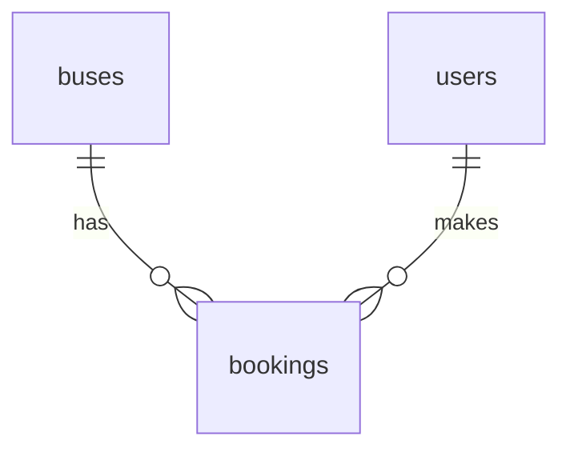

# Data Model: Bus Seat Booking

Database `bus_db` (tests: `bus_db_test`) on Azure SQL Edge. Exactly three tables. Created only by Alembic
migration `0001_create_core_tables`; data comes only from `python -m app.db.seed`.

## Entities

### buses

| Column | Type | Rules |
|--------|------|-------|
| `id` | `INT IDENTITY(1,1)` | Primary key |
| `name` | `NVARCHAR(100)` | NOT NULL, UNIQUE, non-blank |
| `total_seats` | `INT` | NOT NULL, `CHECK (total_seats BETWEEN 1 AND 60)` |

Seats are not stored: seat numbers are `1..total_seats`.

### users

| Column | Type | Rules |
|--------|------|-------|
| `id` | `INT IDENTITY(1,1)` | Primary key |
| `name` | `NVARCHAR(100)` | NOT NULL, UNIQUE, non-blank |

### bookings

| Column | Type | Rules |
|--------|------|-------|
| `id` | `INT IDENTITY(1,1)` | Primary key |
| `bus_id` | `INT` | NOT NULL, FK to `buses.id` |
| `user_id` | `INT` | NOT NULL, FK to `users.id` |
| `seat_number` | `INT` | NOT NULL, `CHECK (seat_number >= 1)` |
| `booked_at` | `DATETIME2(3)` | NOT NULL, UTC, set by the server |

Constraints and indexes:

- `UQ_bookings_bus_seat UNIQUE (bus_id, seat_number)`: the double-booking guard. It also serves the query
  "booked seats for a bus" (leading column `bus_id`).
- No index on `user_id`: no query path in this feature filters by user (added when a "my bookings" feature
  needs it).
- `seat_number <= buses.total_seats` cannot be expressed as a cross-table check; the service enforces it
  (`400 invalid_seat`).

## Relationships

A booking belongs to exactly one bus and one user. One request for N seats creates N rows sharing one
`booked_at`.

## Validation rules (request level, from the spec)

| Rule | Where | Result |
|------|-------|--------|
| `bus_id`, `user_id` are integers >= 1 | Pydantic | 422 |
| `seat_numbers` has 1 to 6 items | Pydantic | 422 |
| Each seat number is an integer >= 1 | Pydantic | 422 |
| No duplicate seat numbers | Pydantic validator | 422 |
| Unknown fields rejected | `extra="forbid"` | 422 |
| Bus exists / user exists | Service | 404 |
| Each seat number <= bus `total_seats` | Service | 400 |
| Seat not already booked | Unique index | 409 |

## State transitions

A seat is `available` until a booking row exists for `(bus_id, seat_number)`, then `booked`. There is no
cancellation in this feature; the only way back to `available` is the seed reset.

## Mock data (seed)

| Table | Rows |
|-------|------|
| `buses` | 1 "Bus A" (20 seats), 2 "Bus B" (30 seats), 3 "Bus C" (40 seats) |
| `users` | 1 "Asha", 2 "Ravi", 3 "Meera" |
| `bookings` | empty |

Reset procedure: `TRUNCATE TABLE bookings` (nothing references it, and it resets the identity counter so new
booking ids start at 1), `DELETE` from `users` and `buses`, then insert the buses and users above with
`SET IDENTITY_INSERT ... ON` and the explicit ids shown (avoids the `DBCC CHECKIDENT ... RESEED` quirk where
a never-used table starts at 0). The result is identical on every run, so ids are stable for tests.
