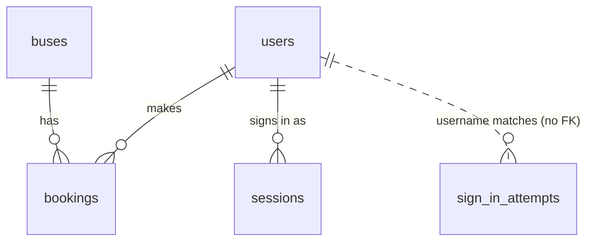
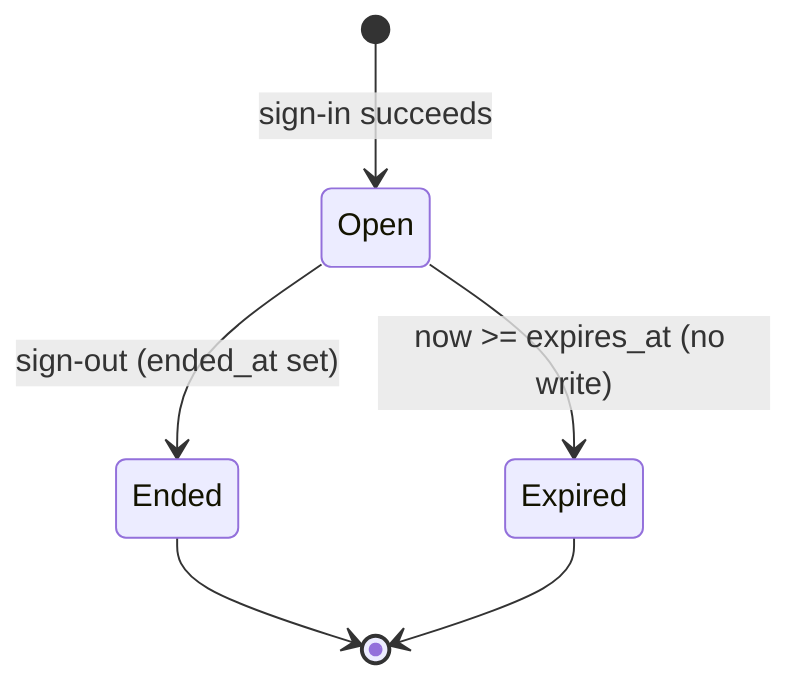

# Data Model: User Authentication

Database `bus_db` (tests: `bus_db_test`) on Azure SQL Edge. Feature 001 created `buses`, `users`, `bookings`
(migration `0001`). This feature adds migration `0002_add_authentication`, which **changes one table and adds two**.
`buses` and `bookings` are unchanged. All new datetimes are `DATETIME2(3)` UTC, written by the server from the injected
`Clock` (never the database clock), through the existing `UtcDateTime` type.

Why each addition is needed (constitution VIII): the username and password hash prove identity (FR-001/002);
`sessions` makes sign-out and expiry effective on the server while the backend stays stateless (FR-022, NFR-007,
NFR-009); `sign_in_attempts` is the audit trail and the failure counter for throttling (FR-011, FR-026, NFR-012).

## Entities

### users (changed)

| Column | Type | Rules |
|--------|------|-------|
| `id` | `INT IDENTITY(1,1)` | Primary key (unchanged) |
| `name` | `NVARCHAR(100)` | NOT NULL, UNIQUE, non-blank (unchanged); display name |
| `username` | `NVARCHAR(50)` | **New.** NOT NULL, `UNIQUE (uq_users_username)`, `CHECK (LEN(LTRIM(RTRIM(username))) > 0)` |
| `password_hash` | `VARCHAR(255)` | **New.** NOT NULL, `CHECK (LEN(password_hash) > 0)`; Argon2id encoded string (about 97 characters), never returned by any API |

Exact matching is enforced by the service (research 6), not by the collation.

### sessions (new)

| Column | Type | Rules |
|--------|------|-------|
| `id` | `CHAR(32)` | Primary key; random UUID4 hex generated by the application (`sid` claim of the token) |
| `user_id` | `INT` | NOT NULL, FK to `users.id` |
| `started_at` | `DATETIME2(3)` | NOT NULL, UTC |
| `expires_at` | `DATETIME2(3)` | NOT NULL, UTC, `CHECK (expires_at > started_at)`; `started_at` + 30 minutes |
| `ended_at` | `DATETIME2(3)` | NULL while the session is open; set by sign-out |

A session is **valid** when `ended_at IS NULL` and `now < expires_at`. The only lookup is by primary key (every
authenticated request), so no further index is needed; there is no query by user (a "my sessions" view would add one).
No password, hash or token is stored in this table.

### sign_in_attempts (new)

| Column | Type | Rules |
|--------|------|-------|
| `id` | `INT IDENTITY(1,1)` | Primary key |
| `username` | `NVARCHAR(50)` | NOT NULL; the username as typed (no FK: unknown usernames are recorded too), never a password |
| `outcome` | `VARCHAR(10)` | NOT NULL, `CHECK (outcome IN ('success','failure','throttled','signout'))` |
| `attempted_at` | `DATETIME2(3)` | NOT NULL, UTC |

Index `ix_sign_in_attempts_username_attempted_at (username, attempted_at)` serves the one query path, "failures for a
username since a time". No foreign key to `users` by design: a failure for `nobody` must be stored and counted.

### buses, bookings (unchanged)

`bookings.user_id` still references `users.id`; after this feature it always holds the id of the session's user.

## Relationships

## Validation rules (request level, from the spec)

| Rule | Where | Result |
|------|-------|--------|
| Sign-in body has exactly `username` and `password` | Pydantic `extra="forbid"` | 422 |
| `username` is a string of 1-50 characters | Pydantic | 422 |
| `password` is a string of 1-128 characters, kept as typed | Pydantic | 422 |
| Booking body has exactly `bus_id` and `seat_numbers` (a `user_id` is rejected) | Pydantic `extra="forbid"` | 422 |
| Credential missing, malformed, forged, altered, wrong scheme, or for a missing user | Gate and `require_session` | 401 `unauthenticated` |
| Session ended or expired | `AuthService.authenticate` | 401 `unauthenticated` |
| Username unknown, wrong password, or another user's password | `AuthService.login` | 401 `invalid_credentials` |
| 5 failures in 5 minutes and less than 60 s since the last failure | `AuthService.login` | 429 `too_many_attempts` |
| Username exact match (case, spaces) | `AuthService.login` (Python compare) | 401 `invalid_credentials` |

Order of checks on sign-in: body validation (422) -> throttle (429) -> user lookup and exact-match -> password
verification (always one Argon2 verification, real or dummy) -> outcome recorded and committed.

## State transitions

`Expired` is derived, never stored. Nothing moves a session back to `Open`. A sign-in attempt row is never updated.

## Migration `0002_add_authentication` (steps, in order)

1. `ALTER TABLE users ADD username NVARCHAR(50) NULL, password_hash VARCHAR(255) NULL`.
2. Back-fill existing rows: `username = LOWER(name)`, `password_hash = '!'` (not a valid Argon2 string, so nobody
   can sign in until the seed writes real hashes; the migration contains no password or hash).
3. `ALTER COLUMN` both to NOT NULL; add `uq_users_username`, `ck_users_username_not_blank`,
   `ck_users_password_hash_not_blank`.
4. `CREATE TABLE sessions`, `CREATE TABLE sign_in_attempts` with the constraints and index above.
5. Downgrade: drop `sign_in_attempts`, `sessions`, the three new constraints, then the two columns.

## Mock data (seed)

| Table | Rows |
|-------|------|
| `buses` | 1 "Bus A" (20), 2 "Bus B" (30), 3 "Bus C" (40) (unchanged) |
| `users` | 1 "Asha" / `asha`, 2 "Ravi" / `ravi`, 3 "Meera" / `meera`; each with an Argon2id hash |
| `bookings`, `sessions`, `sign_in_attempts` | empty |

Reset procedure: `TRUNCATE` `bookings`, `sessions`, `sign_in_attempts` (nothing references them; this also ends every
session, FR-003), `DELETE` `users` then `buses`, re-insert with `IDENTITY_INSERT` and the explicit ids above, writing
`password_hash` from a `username -> hash` map supplied by the caller. Hashing is done by the caller, not by the
reset function, so the function stays a pure SQL routine:

| Caller | Source of passwords | Hasher cost |
|--------|--------------------|-------------|
| `python -m app.db.seed` (dev, e2e) | `MOCK_USER_PASSWORDS` from `.env`; missing user entry stops the run | production defaults |
| pytest session fixture | `secrets.token_urlsafe(16)` per user, generated once per test session, exposed only through a fixture | minimal (time 1, memory 8 MiB) |
