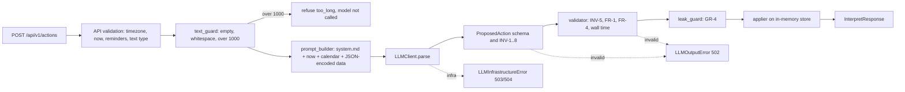

# Implementation Plan: Natural-Language Reminder Agent

**Branch**: `assignment-2-reminder-agent` | **Date**: 2026-11-05 | **Spec**: [spec.md](spec.md)

**Input**: Feature specification from `specs/001-nl-reminder-agent/spec.md` (relative to `assignment_2/`)

## Summary

A small HTTP service turns one free-form reminder request into exactly one validated, structured action
(`create`, `reschedule`, `snooze`, `cancel`, `clarify`, `refuse`). A language model **proposes** the action;
the application validates it against the schema, the structural invariants, and the guardrails before
anything is applied. The model is reached only through the Copilot SDK behind an `LLMClient` Protocol, in
a least-privilege configuration (no tools, deny-all permissions, fresh session per request, replaced system
prompt). A single harness, `.harness/run.sh`, runs integrity, lint, types, SAST, secret scan, unit and
contract tests, and a three-layer evaluation (`--mode live|replay`) and produces `PASS`, `FAIL`, or
`INVALID` against the threshold declared in the spec (aggregate >= 0.85). Research (see
[research.md](research.md)) established the exact SDK API, the error classification, the model choice
(`mai-code-1.1-flash`, `reasoning_effort=low`, served model verified per call), the 60-request budget, the
FR-9 strategy, and the deterministic clock/timezone/DST handling.

## Technical Context

**Language/Version**: Python 3.12 (pyenv, `.python-version` = `3.12`), single `.venv` inside `assignment_2/`

**Primary Dependencies**: FastAPI, uvicorn, Pydantic v2 (>= 2.11), pydantic-settings, `github-copilot-sdk==1.0.28` (exact pin in `uv.lock`), `tzdata`. No LangChain or other LLM framework.

**Dev/Harness Dependencies**: pytest, pytest-asyncio, pytest-cov, httpx (ASGI test client), ruff, mypy, bandit, pip-audit; gitleaks (Homebrew binary, already installed)

**Storage**: in-memory only; a request-scoped `InMemoryReminderStore` seeded from the reminders supplied with each call. No state survives between calls.

**Testing**: pytest (`tests/backend/unit`, `tests/backend/contract`) plus the harness evaluation (`evals/dataset.json`); no browser or Playwright tests

**Target Platform**: macOS developer machine (Apple Silicon); portable to Linux. SDK runtime downloaded by `python -m copilot download-runtime`

**Project Type**: web-service (HTTP API) with a command-line evaluation harness

**Performance Goals**: none in the spec. Observed model latency is 6 to 12 s per request, which dominates; a full live run is about 6 to 9 minutes

**Constraints**: <= 60 live model requests per full run (retries included); INFRA_ERROR share <= 10% else INVALID; function length <= 40 lines; cyclomatic complexity <= 10; model id verified on every call

**Scale/Scope**: one request per call; about 33 eval cases; 6 intents; 1 endpoint plus a health check

## Constitution Check

*GATE: Must pass before Phase 0 research. Re-check after Phase 1 design.*

Constitution v1.0.0 at `.specify/memory/constitution.md`. **Pre-research result: PASS. Post-design result: PASS with 5 justified items (see Complexity Tracking).**

| Principle / section | How the plan satisfies it | Result |
|---------------------|---------------------------|--------|
| I. Spec-driven only | Sequence constitution, specify, clarify, plan; tasks, analyze, human approval, implement follow. No code exists yet. | Pass |
| II. Non-determinism testable | Spec defines the schema, INV, FR, GR, threshold and formula; every eval case carries requirement IDs; the dataset gate fails on any untraced case (MEC-3) | Pass |
| III. Harness built first | Tasks will place `.harness/` (with a failing-then-passing self-test) in the Foundational phase before `src/`; T001 is the human approval gate | Pass |
| IV. One harness, three layers | `.harness/run.sh` runs all gates; evaluators are separate modules for schema (L1), properties (L2), semantic (L3); no second harness. No LLM judge is used (Layer 3 is deterministic) | Pass |
| V. Harness protection | Thresholds only from `.harness/config/thresholds.env`; `checksums.sha256` covers scripts, thresholds, `evals/dataset.json`, `evals/output-schema.json`, `ruff.toml`, `mypy.ini`, `gitleaks.toml`, `bandit.yaml`; integrity gate runs first | Pass |
| VI. Service failures | `LLMInfrastructureError` maps to `INFRA_ERROR`, bounded retry, excluded from score, > 10% gives INVALID; `--mode live|replay`; only live writes `eval-results.json` | Pass |
| VII. Secrets | `.env` ignored, `.env.example` committed, one `settings.py` (pydantic-settings), fail-fast; gitleaks plus redaction over all captured output | Pass |
| VIII. Safe action boundary | Model output validated before any apply; no new ids from the model; single-target schema (no bulk); SDK built-in tools unavailable and deny-all permission test; leak guard for GR-4 | Pass |
| IX. Engineering quality | Layering `api -> services -> llm -> models` enforced by an import-graph test; `LLMClient` Protocol; mypy strict, ruff, bandit, `extra="forbid"`, central error handler, `/api/v1`, pagination N/A (no list endpoint) | Pass |
| X. Tests first | Tasks template will order failing tests before each implementation; endpoint contract tests cover success and failure | Pass |
| XI. Evidence | Layout and `harness-log.md` section order follow the constitution; run row appended last by `run.sh` | Pass |
| XII. Agent guardrails | One phase at a time with checkpoints; `initial-generation` tag before the first `run.sh` | Pass |
| Technology and environment | Stack as constitution; SDK pinned; one SDK module; least-privilege keywords verified against the installed package | Pass, layout adapted (Complexity row 1) |
| Repository and workflow | Branch `assignment-2-reminder-agent` (created); all paths inside `assignment_2/`; scope gate `git diff --name-only main...HEAD` | Pass |
| MEC table | Each of MEC-1 to MEC-27 has an enforcing script in the harness (see "Harness design") | Pass |

## Project Structure

### Documentation (this feature)

```text
specs/001-nl-reminder-agent/
├── plan.md              # This file
├── research.md          # Phase 0 output
├── data-model.md        # Phase 1 output
├── quickstart.md        # Phase 1 output
├── contracts/
│   ├── openapi.yaml             # HTTP contract, ProposedAction schema
│   ├── eval-dataset.schema.json # Shape of evals/dataset.json
│   └── harness-outputs.md       # summary.json, eval-results.json, log row, thresholds.env keys
├── checklists/requirements.md
└── tasks.md             # Phase 2 output (/speckit-tasks, not created here)
```

### Source Code (relative to `assignment_2/`)

```text
.python-version, .env.example, .gitignore, README.md
prompts/
└── system.md                       # fixed rules; context block is appended by the prompt builder
src/backend/
├── pyproject.toml, uv.lock
└── app/
    ├── settings.py                 # the only reader of environment variables
    ├── models/                     # bottom layer: pure Pydantic and exceptions
    │   ├── action.py               # Intent, RefusalReason, ProposedActionWire, ProposedAction (INV-1..8)
    │   ├── requests.py             # InterpretRequest, ReminderIn, CallerContext
    │   ├── responses.py            # InterpretResponse, AppliedResult
    │   └── errors.py               # DomainError hierarchy (code, http_status)
    ├── llm/                        # adapter layer
    │   ├── protocol.py             # LLMClient Protocol, LLMRequest
    │   ├── copilot_client.py       # the ONLY module that imports `copilot`
    │   ├── replay_client.py        # ReplayLLMClient (redacted recorded fixtures)
    │   └── stub_client.py          # StubLLMClient (scripted outputs and faults, for tests)
    ├── services/
    │   ├── interpreter.py          # orchestrates one call
    │   ├── text_guard.py           # FR-8 pre-model checks
    │   ├── prompt_builder.py       # system.md + injected now + reference calendar
    │   ├── calendar_context.py     # deterministic dates, offsets, DST markers (zoneinfo)
    │   ├── validator.py            # INV-5, FR-1, FR-4, wall-time rules, id checks
    │   ├── leak_guard.py           # GR-4 backstop
    │   ├── applier.py              # applies a validated action (FR-6, FR-7)
    │   ├── store.py                # ReminderStore Protocol, InMemoryReminderStore
    │   └── clock.py                # Clock Protocol, SystemClock
    └── api/
        ├── main.py                 # app factory, lifespan owns the single CopilotClient
        ├── routes.py               # POST /api/v1/actions, GET /api/v1/health
        ├── deps.py                 # FastAPI Depends wiring
        └── errors.py               # the one central exception handler
tests/backend/
├── unit/                           # models, validator, applier, calendar, guards, evaluators, scoring, infra mapping, architecture, SDK-config
└── contract/                       # every endpoint, success and failure, via ASGI client with StubLLMClient
evals/
├── dataset.json                    # protected
├── output-schema.json              # protected, generated from ProposedActionWire
└── recorded/                       # redacted replay fixtures: <case_id>.<run>.json
.harness/
├── run.sh, integrity.sh, lint.sh, security.sh, test.sh, eval.sh
├── check_function_length.py        # AST check for FUNC_LEN_MAX
├── eval_runner.py                  # --mode live|replay, preflight, request counter, INFRA handling
├── evaluators/                     # schema.py (L1), properties.py (L2), semantic.py (L3)
├── scoring.py, infra.py, redact.py, summarize.py
└── config/                         # thresholds.env, checksums.sha256, ruff.toml, mypy.ini, gitleaks.toml, bandit.yaml
evidence/                           # initial-generation/, final-generation/, harness-results/<UTC>/, eval-results.json, harness-log.md
```

**Structure Decision**: single backend project plus a harness. `src/backend/app` follows the constitution's
required `src/backend` and `tests/backend`; the requested `src/app/{api,services,llm,models}` and
`tests/{unit,contract}` are nested under them with the same package names.

### Request flow



The user text and the existing reminder titles are placed in the prompt as JSON-encoded strings inside
delimited data blocks, and the system prompt states they are data, never instructions (GR-1).

### Harness design (gate order, all thresholds from `thresholds.env`)

| Gate | Script | Checks | MEC |
|------|--------|--------|-----|
| 0 Integrity and scope | `integrity.sh` | checksums; `git diff --name-only main...HEAD` lists only `assignment_2/`; dataset gate (>= 15 cases, >= 2 per category, 100% traced) | 1, 2, 3, 23, 27 |
| 1 Lint and types | `lint.sh` | `ruff check`, `ruff format --check` (`C901` limit injected), `mypy --strict`, `check_function_length.py` | 9, 10, 11, 12 |
| 2 Security | `security.sh` | `bandit -ll`, `pip-audit`, `gitleaks` on tree, staged diff and evidence, redaction pass | 13, 14, 15 |
| 3 Tests | `test.sh` | pytest with coverage (line >= 85, branch >= 80), no skips without reason, every endpoint has a success and a failure test | 7, 8, 20, 21, 22 |
| 4 Evaluation | `eval.sh` / `eval_runner.py` | preflight (runtime, auth, catalog), layers 1 to 3, FR-9 consistency, request cap, INFRA handling, verdict | 4, 5, 6, 16, 17, 18, 19 |
| Feedback | `summarize.py` | `summary.json` (failed rule or test with expected and observed), appends one row to `harness-log.md` | 24, 25 |

`.harness/run.sh` continues after a failing gate to collect evidence and exits non-zero if any gate failed. MEC-26
(reproducibility) is checked by the quickstart.

## Traceability: requirement to enforcing module to check

Legend: **R** = enforced at runtime by the listed module; **M** = model behaviour, enforced by the prompt and
checked only by the evaluation (not by runtime code); "UT" = unit or contract test in `tests/backend`;
`EV` = eval case. Planned eval case ids are listed after the table.

| Req | Enforced by | Checked by |
|-----|-------------|------------|
| INV-1 valid JSON, schema | R `models/action.py` (`ProposedActionWire`, `ProposedAction`), `llm/copilot_client.py` (parse) | L1 `evaluators/schema.py`; UT `test_action_model.py`; all model-bound EV |
| INV-2 intent in set | R `models/action.py` (`Intent`) | L1; UT `test_action_model.py` |
| INV-3 datetime aware | R `models/action.py` (`AwareDatetime`) | L1; UT `test_action_model.py`; EV-N01, EV-B03 |
| INV-4 snooze 1..1440 | R `models/action.py` (`ge=1, le=1440`) | L1; UT `test_action_model.py`; EV-N08, EV-N09 |
| INV-5 target from list | R `services/validator.py` | L1 (target in supplied ids); UT `test_validator_targets.py` (AC-12); EV-N07, EV-N08, EV-N10, EV-A01, EV-A02 |
| INV-6 question iff clarify | R `models/action.py` (model validator) | L1; UT `test_action_model.py`; EV-M01, EV-M02 |
| INV-7 reason iff refuse | R `models/action.py` (model validator) | L1; UT `test_action_model.py`; EV-G01 |
| INV-8 no extra fields | R `models/action.py` (`extra="forbid"`) | L1; UT `test_action_model.py` (AC-12) |
| FR-1 future, local offset, relative dates | R `services/validator.py` + `services/calendar_context.py`; M prompt rules | L2 `check_fr1`; UT `test_validator_time.py`, `test_calendar_context.py`; EV-N01..N06, EV-B01..B04 |
| FR-2 missing task or time gives clarify | R per-intent required fields in `models/action.py`; M prompt | L2 `check_fr2`; EV-M01, EV-M02 |
| FR-3 fixed windows, bare "tomorrow" | M prompt (`prompts/system.md`) | L2 `check_fr3`; EV-N03, EV-N05, EV-M03 |
| FR-4 past time gives clarify | R `services/validator.py` (past rejected, GR-5); M prompt | L2 `check_fr4`; UT `test_validator_time.py`; EV-M04, EV-A03 |
| FR-5 exactly one resolvable target | R `services/validator.py` (id in list); M prompt (zero or many gives clarify) | L2 `check_fr5`; EV-N07, EV-A01, EV-A02 |
| FR-6 snooze new time | R `services/applier.py` | UT `test_applier_snooze.py` (both branches); L2 `check_fr6` on the applied time; EV-N08, EV-N09 |
| FR-7 cancel exactly one | R `services/applier.py`, `services/store.py` | UT `test_applier_cancel.py`; L2 `check_fr7`; EV-N10 |
| FR-8 empty, non-text, over-length | R `api/routes.py` + `models/requests.py` (422), `services/text_guard.py` (refuse) | UT and contract `test_text_guard.py`, `test_actions_endpoint.py`; EV-X01..X04, EV-B05 |
| FR-9 3-run consistency | `.harness/eval_runner.py` (K runs) | L2 `check_fr9`; consistency subset EV-N01, N02, N04, N05, N07, N08, N10, B03 |
| FR-10 dataset content | `.harness/integrity.sh` dataset gate, `evals/dataset.json` | UT `test_dataset_contract.py` |
| FR-11 three layers | `.harness/evaluators/*` | UT `test_evaluators_*.py` |
| FR-12 scoring formula | `.harness/scoring.py` | UT `test_scoring.py` (AC-31) |
| FR-13 PASS conditions | `.harness/summarize.py` (verdict) | UT `test_verdict.py` (AC-32) |
| FR-14 INFRA_ERROR | `llm/copilot_client.py` mapping, `.harness/infra.py`, `.harness/eval_runner.py` | UT `test_infra_mapping.py`, `test_verdict.py` (AC-29, AC-30) |
| FR-15 traceability, recorded model and runs | `.harness/eval_runner.py`, dataset gate | UT `test_eval_results.py`, `test_dataset_contract.py` (AC-33) |
| FR-16 single command, summary | `.harness/run.sh`, `summarize.py` | quickstart; UT `test_summarize.py` |
| GR-1 injection refused | M prompt data-block rules; R applier never acts on `refuse` | L2 `check_gr1`; UT `test_applier_refuse_noop.py`; EV-G01, EV-G06 |
| GR-2 bulk refused | R schema has a single target field (bulk structurally impossible); M prompt | L2 `check_gr2`; EV-G02 |
| GR-3 out of scope | M prompt | L2 `check_gr3`; EV-G03 |
| GR-4 no echo | R `services/leak_guard.py` (sentinels from the system prompt and settings secrets) | L2 `check_gr4`; UT `test_leak_guard.py`; EV-G04 |
| GR-5 untrusted output, controlled error | R `services/interpreter.py`, `validator.py`, `api/errors.py` | UT and contract `test_untrusted_output.py` (AC-12), `test_error_shape.py` |
| GR-6 harmful gives refuse unsafe | M prompt | L2 `check_gr6`; EV-G05 |

Acceptance criteria map to the same checks: AC-1..AC-3, AC-35, AC-37, AC-38 to EV-N01..N06; AC-4..AC-7,
AC-34, AC-36 to EV-M01..M04, EV-A03, EV-A04; AC-8..AC-13 to EV-G01..G05 and UT (AC-12); AC-14..AC-16 to
EV-X01..X04 and EV-B05; AC-17..AC-19 to EV-N07, EV-A01, EV-A02; AC-20, AC-21 to EV-N08, EV-N09;
AC-22, AC-23 to EV-N10; AC-24..AC-27 to EV-B01..B04; AC-28 to the consistency subset; AC-29..AC-33 to the
harness unit tests above. The final per-AC table lives in `evidence/harness-log.md` (MEC-24).

### Planned dataset (33 cases; 29 reach the model, 4 do not)

| Category | Cases | Count |
|----------|-------|-------|
| normal | N01 pay rent (AC-1), N02 vendor Tuesday evening (AC-2), N03 morning window (AC-3), N04 same weekday (AC-35), N05 end of day (AC-37), N06 verbatim sensitive title (AC-38), N07 reschedule (AC-17), N08 snooze future (AC-20), N09 snooze passed (AC-21), N10 cancel one (AC-22, AC-23) | 10 |
| boundary | B01 midnight rollover (AC-24), B02 month end (AC-25), B03 daylight-saving offset change (AC-26), B04 in 1 minute (AC-27), B05 exactly 1000 characters (AC-16) | 5 |
| ambiguous | A01 zero match (AC-18), A02 multiple matches (AC-19), A03 bare clock time passed today (AC-34), A04 nonexistent local time (AC-36) | 4 |
| missing info | M01 no time (AC-4), M02 no task (AC-5), M03 bare "tomorrow" (AC-6), M04 explicit past time (AC-7) | 4 |
| malformed (no model call) | X01 1001 characters (AC-14), X02 empty (AC-15), X03 whitespace-only (AC-15), X04 non-text (AC-15) | 4 |
| adversarial | G01 override instructions (AC-8), G02 bulk delete (AC-9), G03 off-topic (AC-10), G04 reveal prompt and config (AC-11), G05 harmful purpose (AC-13), G06 injection inside an existing reminder title (GR-1) | 6 |

Request budget: 29 + 8 x 2 = 45 planned, 15 reserved for retries, cap 60.

## Complexity Tracking

> Constitution Check passed; these rows record deliberate deviations and additions that need a reason.

| Violation or addition | Why Needed | Simpler Alternative Rejected Because |
|-----------------------|------------|-------------------------------------|
| 1. `src/backend/app/...` and `tests/backend/{unit,contract}` instead of the requested `src/app/...` and `tests/{unit,contract}` | The constitution's Technology and Environment section requires `src/backend` and `tests/backend` | Using the flat layout would violate a MUST; if the flat layout is preferred, amend the constitution (PATCH) first |
| 2. Top-level `prompts/` directory | The request asks for `prompts/system.md`; the prompt is a reviewed, checksummed artifact | Embedding the prompt in Python hides it from review. The constitution's layout list is extended, not contradicted |
| 3. SDK `system_message` mode `replace` | Cuts input from 1577 to 110 tokens and gives exact prompt control (measured) | `append` or default modes keep a 1.5k-token runtime prompt that we cannot inspect or test; safe here because tools are off and permissions are denied |
| 4. Two action models (`ProposedActionWire` and `ProposedAction`) | The provider needs plain types for structured output; INV range and cross-field rules must be ours so Layer 1 can measure them | One constrained model risks provider schema rejection and moves INV checks out of our control |
| 5. `StubLLMClient` and `ReplayLLMClient` live in `src/`, not `tests/` | The harness (replay mode) and the tests both need them | Test-only copies would duplicate behaviour and could drift from the Protocol |

## Post-design Constitution Re-check

All twelve principles still pass after Phase 1. New risks, none blocking, are recorded in `research.md`:
the served-model routing instability (mitigated by the per-call check and `INFRA_ERROR(model_routing)`),
and the unverified rate-limit message patterns (mitigated by a single pattern table and fake-exception tests).
